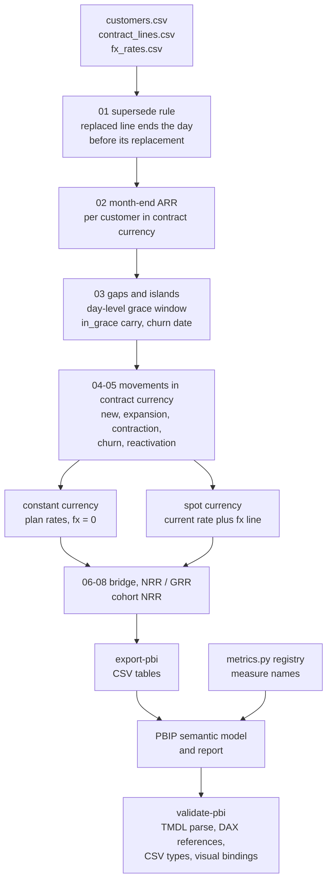

# arrwaterfall

[](https://github.com/SlateGitOrg/arrwaterfall/actions/workflows/ci.yml)


arrwaterfall builds a SaaS ARR bridge from contract lines in a DuckDB SQL pipeline. A renewal signed inside a grace window after expiry is a renewal, not a churn followed by a returning customer. A renewal booked with a one-day overlap counts once. Exchange-rate movement is its own FX line, so it is never read as expansion. Every customer-month closes to the cent, and the same metrics feed a Power BI project (PBIP, TMDL semantic model) that is validated statically against a registry of metric names. All data in the repository is synthetic.

## The problem

A B2B SaaS company with about 900 customers on annual and multi-year contracts reports ARR, churn and net revenue retention from a spreadsheet, and three things go wrong:

- A renewal signed three weeks after expiry shows as a churn followed by a returning customer, which inflates both churn and gross additions.
- A renewal booked with a one-day overlap double-counts a month-end.
- Euro and sterling contracts move dollar ARR with the exchange rate, and the board reads that as expansion.

NRR then depends on who ran the query. This project makes each definition explicit, parameterises the one that is a judgement call (the grace window), and shows how far the numbers move when it changes.

## How it works



The SQL files in `src/arrwaterfall/sql/` run in order from `arrwaterfall.pipeline`:

1. **Supersede.** A line replaced by another ends on the day before its replacement starts.
2. **Month-end ARR.** A line is active at month-end d when `start <= d <= effective end`. Customer ARR is summed in contract currency.
3. **Gaps and islands.** A customer's coverage is the union of its line intervals. When the uncovered gap between two islands is at most `--grace-days` (default 60), the last active ARR is carried with status `in_grace` and the return is a renewal; any change is expansion or contraction. When the gap is longer, churn is booked in the month containing `end + grace + 1 day` and the return is a `reactivation` in the month of the new start. Both can fall in the same month. First-ever ARR is `new`.
4. **Movements** per customer-month: new, expansion, contraction, churn, reactivation, fx. They are classified on contract-currency amounts, so the classification never depends on the exchange rate.
5. **Bridge.** Constant currency prices everything at the plan rate and has no FX. In the spot view each movement is priced at the current month-end rate and FX is the opening contract-currency ARR times the change in rate, so opening + movements + fx = closing exactly.
6. **Metrics.** Closing ARR, logos, gross churn, trailing-12-month NRR and GRR (GRR caps each customer at starting ARR) and cohort NRR by first-contract quarter, all in constant currency.

## Quick start

```bash
python -m venv .venv
.venv/bin/pip install -e ".[dev]"

.venv/bin/arrwaterfall generate --out data --seed 11        # synthetic book
.venv/bin/arrwaterfall build --data data --out out          # pipeline plus rigour checks
.venv/bin/arrwaterfall bridge --data data --view spot       # last 12 months of the bridge
.venv/bin/arrwaterfall bridge --data data --cohorts         # cohort NRR
.venv/bin/arrwaterfall sensitivity --data data              # grace 0 / 30 / 60 / 90
.venv/bin/arrwaterfall export-pbi --data data --out powerbi/data
.venv/bin/arrwaterfall validate-pbi --project powerbi --data-dir powerbi/data
```

To open the report in Power BI Desktop, run `export-pbi`, open `powerbi/ArrWaterfall.pbip` and set the `DataFolder` parameter to the absolute path of `powerbi/data`. Power BI Desktop is not needed for anything else.

## Example output

The numbers below come from `generate --seed 11` followed by the commands in Quick start.

`build` runs the checks after the pipeline and exits non-zero if any fails:

```text
[ok] bridge residual: largest customer-month residual 0.000000 USD (limit 0.01)
[ok] closing ARR vs independent sum of lines: largest difference 0.000000 in contract currency
[ok] closing ARR minus active lines equals in-grace ARR: in-grace ARR carried over all months 4,834,200
[ok] no returning customer is booked as new: 0 new bookings after earlier ARR, 0 customers with two
[ok] GRR <= 1 and GRR <= NRR in every month: 0 violating months
grace window 60 days; tables written to out/
```

Spot-view bridge, last 12 months, USD (contraction and churn are shown negative; the first month-end of the data only seeds the opening balance):

| Month   |    Opening |       New | Expansion | Contraction |    Churn | Reactivation |      FX |    Closing |
|:--------|-----------:|----------:|----------:|------------:|---------:|-------------:|--------:|-----------:|
| 2025-11 | 37,754,871 |   324,089 |   265,791 |     -21,500 | -124,401 |            0 |  21,049 | 38,219,900 |
| 2025-12 | 38,219,900 | 1,091,350 |    60,305 |      -6,743 |        0 |      124,656 |   3,034 | 39,492,502 |
| 2026-01 | 39,492,502 |   566,612 |   135,569 |     -55,591 |        0 |       60,400 |  46,203 | 40,245,696 |
| 2026-02 | 40,245,696 | 1,256,700 |   162,684 |     -42,735 |        0 |            0 |  43,848 | 41,666,192 |
| 2026-03 | 41,666,192 | 1,157,129 |   210,611 |     -41,443 | -186,500 |            0 | 168,522 | 42,974,510 |
| 2026-04 | 42,974,510 |   379,477 |   132,374 |     -45,237 | -192,337 |       98,500 | -13,122 | 43,334,165 |
| 2026-05 | 43,334,165 |   480,346 |   107,523 |     -45,400 |  -67,887 |            0 | -29,731 | 43,779,016 |
| 2026-06 | 43,779,016 |   780,900 |    96,649 |     -30,500 | -226,700 |       70,574 |  38,751 | 44,508,691 |
| 2026-07 | 44,508,691 |   662,321 |   410,188 |    -160,872 |  -24,700 |      227,400 |  35,784 | 45,658,812 |
| 2026-08 | 45,658,812 |   693,096 |   195,205 |    -365,661 | -112,709 |            0 |  87,627 | 46,156,371 |
| 2026-09 | 46,156,371 |   255,020 |   290,965 |     -58,241 |  -91,016 |        5,800 |  11,520 | 46,570,419 |
| 2026-10 | 46,570,419 |         0 |   261,967 |    -111,461 |        0 |            0 |   4,917 | 46,725,842 |

Grace-window sensitivity. ARR is constant currency and covers all 47 bridge months; GRR is the trailing-12-month ratio, averaged over the 36 months that have one and at the latest month-end:

| Grace days | Churn events | Churn ARR | Reactivations | Reactivation ARR | GRR TTM (mean) | GRR TTM (latest) |
|:-----------|-------------:|----------:|--------------:|-----------------:|---------------:|-----------------:|
| 0          |           55 | 4,235,860 |            46 |        3,569,647 |         0.9686 |           0.9637 |
| 30         |           44 | 3,536,858 |            35 |        2,877,928 |         0.9708 |           0.9637 |
| 60         |           33 | 2,875,728 |            24 |        2,203,288 |         0.9731 |           0.9640 |
| 90         |           15 |   648,517 |             6 |          130,300 |         0.9752 |           0.9639 |

Cohort NRR for the last four first-contract quarters that have a +12-month reading. A cohort's base is its ARR at the month-end that closes its quarter, and NRR +k is the same customers' ARR k months later:

| Cohort  | Customers |  Base ARR | NRR +3m | NRR +6m | NRR +9m | NRR +12m |
|:--------|----------:|----------:|--------:|--------:|--------:|---------:|
| 2024-Q4 |        37 | 1,571,306 |  1.0188 |  1.0210 |  1.0346 |   1.0116 |
| 2025-Q1 |        39 | 1,169,052 |  1.0176 |  1.0196 |  1.0230 |   0.9837 |
| 2025-Q2 |        38 | 1,119,769 |  1.0042 |  1.0130 |  1.0130 |   0.9911 |
| 2025-Q3 |        47 | 2,612,776 |  1.0026 |  1.0113 |  1.0254 |   1.0003 |

In the synthetic book, 40 late renewals have gaps of 5 to 85 days, 15 customers truly churn (6 of them return 7 to 10 months later), and EUR spot rises 8% in month 30 with no EUR contract change that month. The sensitivity table recovers that: 15 churn events at 90 days, where all 40 late renewals are renewals, and 55 at 0 days.

## Design decisions

- **Classify in contract currency, price afterwards.** A customer whose euro ARR does not change can never show expansion because the rate moved. The cost is that the spot view prices flows at the current month-end rate, so a movement and the FX line are defined by a convention (flow at current rate, FX on opening balance). It is exact and has no residual, but a different convention would split the same total differently.
- **Day-level grace window.** The window is measured in days between the old end date and the new start date, not in months between snapshots, so a 59-day and a 61-day gap fall on opposite sides of a 60-day window whichever month-ends they straddle. A gap that contains no month-end never appears in a month-end series and is ignored whatever its length.
- **In-grace ARR is part of closing ARR.** A customer inside the window is still counted, as the definition requires. So closing ARR is the sum of active lines plus carried in-grace ARR, not the sum of active lines alone. The pipeline checks both halves separately: active ARR equals an independent pandas sum of non-superseded lines, and the difference to closing ARR equals the in-grace ARR.
- **Churn is dated at the end of the window.** Booking churn at `end + grace + 1` means a larger window delays churn instead of only suppressing it, and a customer who lapses and returns in the same month records both a churn and a reactivation. Customers still in grace at the last month-end have no churn yet.
- **The SQL is the reference, the Power BI model is validated statically.** DAX cannot run in CI, so the tested numbers come from SQL and Python. `validate-pbi` parses every TMDL file, resolves each column and measure reference in each DAX measure, flags time-shifting CALCULATE calls that do not clear the date table and MIN/MAX over bare CALCULATE terms (both give wrong or BLANK results in a visual), compares TMDL columns to the CSV headers and types, requires the measure names to equal the registry in `metrics.py`, and resolves each visual binding. It does not evaluate DAX, so a measure can pass validation and still return the wrong number. TMDL support is the subset this project uses.
- **One added table.** `export-pbi` writes a sixth table, `FactGraceSensitivity`, next to the five model tables so the report's sensitivity page has data to show.

## Testing

```bash
.venv/bin/python -m pytest -q
uvx ruff check . && uvx ruff format --check .
```

The tests run offline against the generated book and a hand-computed fixture. They cover:

- Bridge residual below $0.01 for every customer-month in both views and at every grace window.
- Closing ARR against an independent sum of active, non-superseded lines.
- The 10 overlap renewals count once at the overlap month-end.
- Churn and reactivation counts equal `15 + late renewals with gap > G` and `6 + late renewals with gap > G` for G = 0, 30, 60, 90, using `truth.json`.
- No returning customer is booked as `new`.
- Month 30: EUR FX equals prior EUR ARR times the rate change, and EUR expansion is 0.
- A five-customer, 14-month fixture in `tests/fixtures/` with a co-termed upgrade; TTM NRR and GRR are asserted against values derived by hand in the test.
- GRR <= 1 and GRR <= NRR in every month.
- `validate-pbi` passes the shipped project and fails damaged copies, naming the bad reference.

## Project layout

```text
src/arrwaterfall/
  cli.py          typer commands
  synth.py        seeded synthetic book with injected events and truth.json
  pipeline.py     loads the CSVs, runs sql/ in order, checks inputs
  sql/            00 inputs, 01 supersede, 02 month ARR, 03 lapse, 04 status,
                  05 movements, 06 bridge, 07 metrics, 08 cohorts
  metrics.py      registry of movement types, bridge columns and measure names
  checks.py       residual, independent reconciliation and other build checks
  sensitivity.py  grace-window runs
  reporting.py    markdown tables
  export.py       CSV tables for Power BI and their schema
  pbi/            TMDL parser and the PBIP validator
powerbi/
  ArrWaterfall.pbip
  ArrWaterfall.SemanticModel/   definition.pbism, definition/*.tmdl
  ArrWaterfall.Report/          definition.pbir, report.json (Bridge, Cohorts, Definition sensitivity)
  data/                         export-pbi writes the CSVs here (git-ignored)
tests/                          pytest suite and tests/fixtures/
```

## License

MIT. See `LICENSE`.
